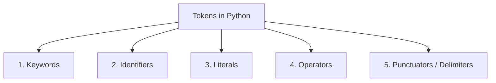

# Day 3: Tokens and Data Types in Python 🐍

[](https://www.python.org/)
[]()
[](https://github.com/harish-0987)

> **Motto**: *"Not here to be known, here to build."*

Welcome to **Day 3 of Python**! Today's lesson covers two foundational pillars of programming in Python:
1. **What is a Token?** and the **5 Types of Tokens**.
2. **What is a Data Type?** and Python's built-in data types, type checking, and type conversion.

---

## 📌 Table of Contents
- [What is a Token?](#-what-is-a-token)
- [The 5 Types of Tokens](#-the-5-types-of-tokens)
  - [1. Keywords](#1-keywords)
  - [2. Identifiers](#2-identifiers)
  - [3. Literals](#3-literals)
  - [4. Operators](#4-operators)
  - [5. Punctuators / Delimiters](#5-punctuators--delimiters)
- [What is a Data Type?](#-what-is-a-data-type)
- [Python Built-in Data Types](#-python-built-in-data-types)
- [Type Checking & Type Conversion](#-type-checking--type-conversion)
- [File Structure](#-file-structure)
- [How to Run](#-how-to-run)
- [Author](#-author)

---

## 📖 What is a Token?

A **token** is the **smallest individual unit** or building block in a Python program. 

Just as a sentence in English is composed of individual words, punctuation marks, and symbols, a Python program is broken down into tokens by the interpreter during compilation/parsing.

Every single element you write in Python is classified as one of five token types.

---

## 🧱 The 5 Types of Tokens



### 1. Keywords
Keywords are **reserved words** that have a predefined, special meaning to the Python interpreter. You **cannot** use them as variable names, function names, or identifiers.

```python
import keyword
print(keyword.kwlist)  # Displays all reserved keywords in your Python version
```
- **Common Examples**: `if`, `else`, `elif`, `for`, `while`, `def`, `return`, `class`, `import`, `True`, `False`, `None`, `try`, `except`.

---

### 2. Identifiers
An **identifier** is a user-defined name given to program elements like variables, functions, classes, or modules.

#### Rules for Naming Identifiers:
- Can contain letters (`a-z`, `A-Z`), digits (`0-9`), and underscores (`_`).
- Must **start** with a letter or an underscore (`_`). **Cannot** start with a digit (e.g., `1name` ❌, `name1` ✅).
- Cannot be a reserved Python keyword.
- Identifiers are **case-sensitive** (`age`, `Age`, and `AGE` are three different identifiers).
- Special characters like `@`, `$`, `%` are not allowed.

```python
# Valid Identifiers
user_name = "Harish"
total_score = 98
_private_var = 42

# Invalid Identifiers
# 2nd_user = "Invalid"  ❌ Starts with digit
# class = "Invalid"     ❌ Reserved keyword
# my-name = "Invalid"   ❌ Hyphen not allowed
```

---

### 3. Literals
Literals are **fixed, raw constant values** assigned directly to variables.

| Literal Type | Description | Example |
| :--- | :--- | :--- |
| **String Literals** | Text enclosed in single, double, or triple quotes | `"Hello"`, `'Python'` |
| **Numeric Literals** | Whole numbers, decimals, complex numbers | `42` (int), `3.14` (float), `2+3j` (complex) |
| **Boolean Literals** | Represents truth values | `True`, `False` |
| **Special Literal** | Represents the absence of a value | `None` |
| **Collection Literals**| Lists, Tuples, Dictionaries, Sets | `[1, 2]`, `(1, 2)`, `{"a": 1}`, `{1, 2}` |

---

### 4. Operators
Operators are special symbols used to carry out mathematical, relational, or logical computations on values (operands).

- **Arithmetic Operators**: `+`, `-`, `*`, `/`, `//` (floor division), `%` (modulus), `**` (exponentiation)
- **Comparison / Relational Operators**: `==`, `!=`, `>`, `<`, `>=`, `<=`
- **Assignment Operators**: `=`, `+=`, `-=`, `*=`, `/=`, etc.
- **Logical Operators**: `and`, `or`, `not`
- **Identity Operators**: `is`, `is not`
- **Membership Operators**: `in`, `not in`
- **Bitwise Operators**: `&`, `|`, `^`, `~`, `<<`, `>>`

---

### 5. Punctuators / Delimiters
Punctuators (or delimiters) are symbols used to organize code structure, group expressions, or separate statements and items.

| Symbol | Name | Primary Usage in Python |
| :--- | :--- | :--- |
| `( )` | Parentheses | Function calls, order of operations, tuples |
| `[ ]` | Square Brackets | Lists, string/list indexing and slicing |
| `{ }` | Curly Braces | Dictionaries, sets |
| `:` | Colon | Code blocks (`if`, `for`, `while`, `def`, `class`) |
| `,` | Comma | Separating elements in lists, parameters, etc. |
| `.` | Period / Dot | Accessing attributes or methods of an object |
| `=` | Equals | Variable assignment |

---

## 💡 What is a Data Type?

A **data type** defines the type of value a variable can store and specifies what operations can be performed on that data.

Python is **dynamically typed**, which means:
- You do **not** need to declare data types explicitly.
- The interpreter automatically detects the type at runtime based on the assigned value.

```python
x = 10         # Python detects x as int
x = "Python"   # x is now a str (dynamically typed)
```

---

## 📊 Python Built-in Data Types

| Category | Data Type | Description | Example |
| :--- | :--- | :--- | :--- |
| **Numeric** | `int` | Integer / Whole numbers | `age = 25` |
| | `float` | Floating point / Decimals | `price = 99.99` |
| | `complex` | Numbers with real & imaginary parts | `c = 3 + 4j` |
| **Sequence** | `str` | Text / String of characters | `name = "Harish"` |
| | `list` | Ordered, mutable collection | `fruits = ["apple", "mango"]` |
| | `tuple` | Ordered, immutable collection | `point = (10, 20)` |
| **Mapping** | `dict` | Key-value pairs | `user = {"id": 1, "name": "Harish"}` |
| **Set** | `set` | Unordered collection of unique items | `unique_ids = {1, 2, 3}` |
| | `frozenset` | Immutable set | `frozen = frozenset([1, 2, 3])` |
| **Boolean** | `bool` | True or False | `is_valid = True` |
| **Binary** | `bytes`, `bytearray` | Raw binary sequences | `data = b"Hello"` |
| **None** | `NoneType` | Null value / Absence of value | `result = None` |

---

## 🔍 Type Checking & Type Conversion

### 1. Checking Types
- `type(var)`: Returns the data type of the variable.
- `isinstance(var, type)`: Checks if a variable is an instance of a specified type.

```python
num = 100
print(type(num))                # <class 'int'>
print(isinstance(num, int))     # True
```

### 2. Type Conversion (Type Casting)
- **Implicit Conversion**: Python automatically converts one data type to another without data loss.
  ```python
  a = 10     # int
  b = 2.5    # float
  result = a + b  # result is 12.5 (float)
  ```
- **Explicit Conversion**: Manually converting one type into another using functions like `int()`, `float()`, `str()`, `list()`, `tuple()`.
  ```python
  val_str = "100"
  val_num = int(val_str)   # Converts string "100" to integer 100
  val_flt = float(val_num) # Converts integer 100 to float 100.0
  ```

---

## 📂 File Structure

```text
Day-3-of-Python/
├── README.md       # Comprehensive documentation of Tokens & Data Types
└── day3.py         # Main executable Python script with full examples
```

---

## 💻 How to Run

### 1. Clone the Repository
```bash
git clone https://github.com/harish-0987/Day-3-of-Python.git
cd Day-3-of-Python
```

### 2. Run the Script
```bash
python day3.py
```

---

## 👤 Author
- **Harish**
- GitHub: [@harish-0987](https://github.com/harish-0987)
- Motto: *"Not here to be known, here to build."*
