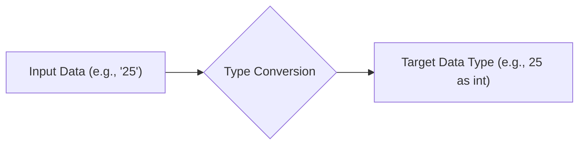
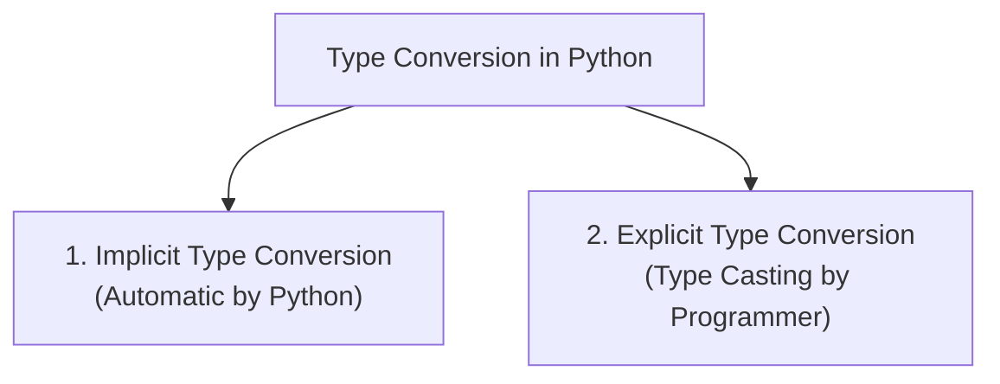

# Day 4: Type Conversion (Type Casting) in Python 🐍

[](https://www.python.org/)
[]()
[](https://github.com/harish-0987)

> **Motto**: *"Not here to be known, here to build."*

Welcome to **Day 4 of Python**! Today's lesson focuses on **Type Conversion** (also known as **Type Casting**) — an essential programming concept for converting data between different types and manipulating variables reliably.

---

## 📌 Table of Contents
- [What is Type Conversion?](#-what-is-type-conversion)
- [Why Do We Need Type Conversion?](#-why-do-we-need-type-conversion)
- [Types of Type Conversion](#-types-of-type-conversion)
  - [1. Implicit Type Conversion (Automatic)](#1-implicit-type-conversion-automatic)
  - [2. Explicit Type Conversion (Type Casting)](#2-explicit-type-conversion-type-casting)
- [Common Built-in Conversion Functions](#-common-built-in-conversion-functions)
- [Truthy and Falsy Values (`bool()`)](#-truthy-and-falsy-values-bool)
- [Common Errors and Pitfalls](#-common-errors-and-pitfalls)
- [Real-World Practical Examples](#-real-world-practical-examples)
- [File Structure](#-file-structure)
- [How to Run](#-how-to-run)
- [Author](#-author)

---

## 📖 What is Type Conversion?

**Type Conversion** is the process of converting a value from one data type into another data type (e.g., converting an integer to a float, or a numeric string to an integer).



---

## 🎯 Why Do We Need Type Conversion?

1. **User Inputs are Strings**: Functions like `input()` in Python always return strings. To perform arithmetic operations on input numbers, we must convert them to `int` or `float`.
2. **Prevent Type Errors**: Python is a **strongly typed** language, meaning it won't allow incompatible operations like `"Total: " + 100` without explicit conversion.
3. **Data Cleaning and Transformation**: Processing data from APIs, databases, or files often requires formatting values into appropriate types.

---

## 🔄 Types of Type Conversion

Python supports two main forms of type conversion:



---

### 1. Implicit Type Conversion (Automatic)

In **Implicit Type Conversion**, Python automatically converts one data type to another without any intervention from the developer.

- Python avoids data loss by converting the lower/smaller data type (e.g., integer) to the higher/wider data type (e.g., float).

#### Example:
```python
x = 10     # int
y = 2.5    # float

# Python automatically converts x to float before addition
result = x + y
print(result)         # Output: 12.5
print(type(result))   # Output: <class 'float'>
```

#### Arithmetic with Booleans:
In Python, `bool` is a subclass of `int`. `True` evaluates to `1`, and `False` evaluates to `0`:
```python
score = 40
print(score + True)   # Output: 41 (40 + 1)
print(score + False)  # Output: 40 (40 + 0)
```

---

### 2. Explicit Type Conversion (Type Casting)

In **Explicit Type Conversion**, the programmer manually transforms an object's data type using Python's built-in functions.

#### Common Built-in Conversion Functions:

| Function | Description | Example | Result |
| :--- | :--- | :--- | :--- |
| `int(x)` | Converts `x` to an integer | `int("42")` | `42` |
| `float(x)` | Converts `x` to a floating-point number | `float("3.14")` | `3.14` |
| `str(x)` | Converts `x` to its string representation | `str(100)` | `'100'` |
| `bool(x)` | Converts `x` to a boolean | `bool(0)` | `False` |
| `list(x)` | Converts iterable `x` to a list | `list("CAT")` | `['C', 'A', 'T']` |
| `tuple(x)` | Converts iterable `x` to a tuple | `tuple([1, 2, 3])` | `(1, 2, 3)` |
| `set(x)` | Converts iterable `x` to a set (unique elements) | `set([1, 1, 2])` | `{1, 2}` |
| `dict(x)` | Converts key-value pairs to a dictionary | `dict([('a', 1)])` | `{'a': 1}` |

---

## ⚖️ Truthy and Falsy Values (`bool()`)

When converting values to `bool`, Python evaluates them according to truth value testing:

| Falsy Values (`False`) | Truthy Values (`True`) |
| :--- | :--- |
| `0`, `0.0`, `0j` | Any non-zero number (`1`, `-5`, `3.14`) |
| `""` (Empty string) | Non-empty string (`"Hello"`, `" "`) |
| `[]` (Empty list) | Non-empty list (`[1, 2]`) |
| `()` (Empty tuple) | Non-empty tuple (`(10,)`) |
| `{}` (Empty dict) | Non-empty dict (`{"k": "v"}`) |
| `set()` (Empty set) | Non-empty set (`{1, 2}`) |
| `None` | Any valid object |

---

## ⚠️ Common Errors and Pitfalls

### 1. Incompatible String to Integer
```python
val = int("hello")  # Raises ValueError: invalid literal for int() with base 10: 'hello'
```

### 2. Converting Float String Directly to Integer
```python
val = int("12.34")  # Raises ValueError
# Correct way: convert to float first, then int
val = int(float("12.34"))  # Output: 12
```

---

## 🛠️ Real-World Practical Examples

### 1. Handling User Calculation
```python
price = float("19.99")
quantity = int("4")
total = price * quantity
print(f"Total: ${total:.2f}")  # Total: $79.96
```

### 2. Deduplicating a Sequence
```python
tags = ["python", "code", "python", "dev", "code"]
unique_tags = list(set(tags))
print(unique_tags)  # ['code', 'python', 'dev']
```

---

## 📁 File Structure

```text
DAY-4-OF-PYTHON/
├── day4.py        # Complete, runnable Python tutorial script on Type Conversion
└── README.md      # Detailed documentation & notes
```

---

## 🚀 How to Run

Clone the repository and run `day4.py`:

```bash
# Clone the repository
git clone https://github.com/harish-0987/DAY-4-OF-PYTHON.git

# Navigate into the folder
cd DAY-4-OF-PYTHON

# Run the script
python day4.py
```

---

## 👨‍💻 Author

**Harish**
- GitHub: [@harish-0987](https://github.com/harish-0987)
- Learning Series: Python from Zero to Hero
- *"Not here to be known, here to build."*
